# Nova Social - Entity Relationship Diagram & Database Design

This document provides the complete database design for the **Nova Social** platform, covering all 18 core and relational entities:
- `users`
- `profiles`
- `posts`
- `post_media`
- `comments`
- `likes` (Polymorphic: posts, comments)
- `saves` (Post bookmarks)
- `follows` (Follower/following graph with approval status)
- `stories`
- `story_views`
- `conversations`
- `conversation_participants`
- `messages`
- `notifications` (Laravel-compliant polymorphic notification storage)
- `hashtags`
- `post_hashtags` (Pivot table)
- `reports` (Polymorphic content and user moderation reports)
- `blocks` (User blocking graph)

---

## 1. High-Level Entity Relationship Diagram (ERD)

```mermaid
erDiagram
    USERS ||--|| PROFILES : "has"
    USERS ||--o{ POSTS : "authors"
    POSTS ||--|{ POST_MEDIA : "contains"
    POSTS ||--o{ COMMENTS : "has"
    USERS ||--o{ COMMENTS : "writes"
    COMMENTS ||--o{ COMMENTS : "replies_to"
    USERS ||--o{ LIKES : "performs"
    USERS ||--o{ SAVES : "bookmarks"
    POSTS ||--o{ SAVES : "saved_by"
    USERS ||--o{ FOLLOWS : "follower"
    USERS ||--o{ FOLLOWS : "following"
    USERS ||--o{ STORIES : "creates"
    STORIES ||--o{ STORY_VIEWS : "tracked_in"
    USERS ||--o{ STORY_VIEWS : "views"
    CONVERSATIONS ||--|{ CONVERSATION_PARTICIPANTS : "includes"
    USERS ||--o{ CONVERSATION_PARTICIPANTS : "participates_in"
    CONVERSATIONS ||--o{ MESSAGES : "contains"
    USERS ||--o{ MESSAGES : "sends"
    POSTS ||--o{ POST_HASHTAGS : "tagged_with"
    HASHTAGS ||--o{ POST_HASHTAGS : "categorizes"
    USERS ||--o{ REPORTS : "files"
    USERS ||--o{ BLOCKS : "initiates_block"
    USERS ||--o{ BLOCKS : "receives_block"
    USERS ||--o{ NOTIFICATIONS : "receives"

    USERS {
        bigint id PK
        string name
        string username UK
        string email UK
        string password
        boolean is_private
        boolean is_active
        enum role
        timestamp created_at
        timestamp updated_at
        timestamp deleted_at
    }

    PROFILES {
        bigint id PK
        bigint user_id FK,UK
        string bio
        string website
        string avatar_url
        string cover_url
        string location
        timestamp created_at
        timestamp updated_at
    }

    POSTS {
        bigint id PK
        bigint user_id FK
        text caption
        string location
        boolean comments_disabled
        int likes_count
        int comments_count
        int saves_count
        timestamp created_at
        timestamp updated_at
        timestamp deleted_at
    }

    POST_MEDIA {
        bigint id PK
        bigint post_id FK
        enum media_type
        string url
        string thumbnail_url
        int order
        timestamp created_at
        timestamp updated_at
    }

    COMMENTS {
        bigint id PK
        bigint post_id FK
        bigint user_id FK
        bigint parent_id FK
        text content
        int likes_count
        timestamp created_at
        timestamp updated_at
        timestamp deleted_at
    }

    LIKES {
        bigint id PK
        bigint user_id FK
        string likeable_type
        bigint likeable_id
        timestamp created_at
        timestamp updated_at
    }

    SAVES {
        bigint id PK
        bigint user_id FK
        bigint post_id FK
        timestamp created_at
        timestamp updated_at
    }

    FOLLOWS {
        bigint id PK
        bigint follower_id FK
        bigint following_id FK
        enum status
        timestamp created_at
        timestamp updated_at
    }

    STORIES {
        bigint id PK
        bigint user_id FK
        enum media_type
        string media_url
        string caption
        int views_count
        timestamp expires_at
        timestamp created_at
        timestamp updated_at
    }

    STORY_VIEWS {
        bigint id PK
        bigint story_id FK
        bigint viewer_id FK
        timestamp viewed_at
    }

    CONVERSATIONS {
        bigint id PK
        enum type
        string title
        string avatar_url
        bigint created_by FK
        timestamp last_message_at
        timestamp created_at
        timestamp updated_at
    }

    CONVERSATION_PARTICIPANTS {
        bigint id PK
        bigint conversation_id FK
        bigint user_id FK
        enum role
        bigint last_read_message_id
        timestamp joined_at
        timestamp left_at
    }

    MESSAGES {
        bigint id PK
        bigint conversation_id FK
        bigint sender_id FK
        text body
        string media_url
        enum media_type
        boolean is_read
        timestamp created_at
        timestamp updated_at
        timestamp deleted_at
    }

    NOTIFICATIONS {
        uuid id PK
        string type
        string notifiable_type
        bigint notifiable_id
        json data
        timestamp read_at
        timestamp created_at
        timestamp updated_at
    }

    HASHTAGS {
        bigint id PK
        string name UK
        int posts_count
        timestamp created_at
        timestamp updated_at
    }

    POST_HASHTAGS {
        bigint id PK
        bigint post_id FK
        bigint hashtag_id FK
        timestamp created_at
    }

    REPORTS {
        bigint id PK
        bigint reporter_id FK
        string reportable_type
        bigint reportable_id
        enum reason
        text details
        enum status
        bigint reviewed_by FK
        text resolution_notes
        timestamp created_at
        timestamp updated_at
    }

    BLOCKS {
        bigint id PK
        bigint blocker_id FK
        bigint blocked_id FK
        timestamp created_at
        timestamp updated_at
    }
```

---

## 2. Detailed Schema Definitions

### 2.1 `users`
Core user identity and authentication credentials.

| Column | Type | Nullable | Default | Constraints & Foreign Keys | Description |
|---|---|---|---|---|---|
| `id` | `BIGINT UNSIGNED` | No | AUTO_INCREMENT | `PRIMARY KEY` | Unique user identifier |
| `name` | `VARCHAR(255)` | No | - | - | Display name |
| `username` | `VARCHAR(30)` | No | - | `UNIQUE` | Unique user handle (a-z, 0-9, _, .) |
| `email` | `VARCHAR(255)` | No | - | `UNIQUE` | Unique account email address |
| `email_verified_at` | `TIMESTAMP` | Yes | `NULL` | - | Email verification timestamp |
| `password` | `VARCHAR(255)` | No | - | - | Bcrypt/Argon2 hashed password |
| `remember_token` | `VARCHAR(100)` | Yes | `NULL` | - | Laravel remember me token |
| `is_private` | `BOOLEAN` | No | `FALSE` | - | Private account flag (requires follow approval) |
| `is_active` | `BOOLEAN` | No | `TRUE` | - | Moderation status (account enabled/suspended) |
| `role` | `ENUM('user', 'moderator', 'admin')` | No | `'user'` | - | Role-based authorization tier |
| `created_at` | `TIMESTAMP` | Yes | `NULL` | - | Account creation timestamp |
| `updated_at` | `TIMESTAMP` | Yes | `NULL` | - | Last account update timestamp |
| `deleted_at` | `TIMESTAMP` | Yes | `NULL` | - | Soft delete timestamp |

**Indexes:**
- `PRIMARY KEY (id)`
- `UNIQUE INDEX idx_users_username (username)`
- `UNIQUE INDEX idx_users_email (email)`
- `INDEX idx_users_role_is_active (role, is_active)`
- `INDEX idx_users_created_at (created_at)`

---

### 2.2 `profiles`
Extended profile information, decoupled from authentication credentials.

| Column | Type | Nullable | Default | Constraints & Foreign Keys | Description |
|---|---|---|---|---|---|
| `id` | `BIGINT UNSIGNED` | No | AUTO_INCREMENT | `PRIMARY KEY` | Primary key |
| `user_id` | `BIGINT UNSIGNED` | No | - | `FOREIGN KEY (user_id) REFERENCES users(id) ON DELETE CASCADE`, `UNIQUE` | 1:1 owner link |
| `bio` | `VARCHAR(500)` | Yes | `NULL` | - | User self-biography |
| `website` | `VARCHAR(255)` | Yes | `NULL` | - | External profile URL |
| `avatar_url` | `VARCHAR(2048)` | Yes | `NULL` | - | S3/Local public avatar image path |
| `cover_url` | `VARCHAR(2048)` | Yes | `NULL` | - | S3/Local public header image path |
| `location` | `VARCHAR(100)` | Yes | `NULL` | - | Geographic location / city |
| `created_at` | `TIMESTAMP` | Yes | `NULL` | - | Profile creation timestamp |
| `updated_at` | `TIMESTAMP` | Yes | `NULL` | - | Profile update timestamp |

**Indexes:**
- `PRIMARY KEY (id)`
- `UNIQUE INDEX idx_profiles_user_id (user_id)`

---

### 2.3 `posts`
Feed posts published by users.

| Column | Type | Nullable | Default | Constraints & Foreign Keys | Description |
|---|---|---|---|---|---|
| `id` | `BIGINT UNSIGNED` | No | AUTO_INCREMENT | `PRIMARY KEY` | Post ID |
| `user_id` | `BIGINT UNSIGNED` | No | - | `FOREIGN KEY (user_id) REFERENCES users(id) ON DELETE CASCADE` | Post author |
| `caption` | `TEXT` | Yes | `NULL` | - | Post description, tags, and mentions |
| `location` | `VARCHAR(255)` | Yes | `NULL` | - | Optional tagged location name |
| `comments_disabled` | `BOOLEAN` | No | `FALSE` | - | Prevent comments on this post |
| `likes_count` | `INT UNSIGNED` | No | `0` | - | Denormalized count for fast feed sorting |
| `comments_count` | `INT UNSIGNED` | No | `0` | - | Denormalized comment count |
| `saves_count` | `INT UNSIGNED` | No | `0` | - | Denormalized bookmark count |
| `created_at` | `TIMESTAMP` | Yes | `NULL` | - | Publication timestamp |
| `updated_at` | `TIMESTAMP` | Yes | `NULL` | - | Modification timestamp |
| `deleted_at` | `TIMESTAMP` | Yes | `NULL` | - | Soft delete timestamp |

**Indexes:**
- `PRIMARY KEY (id)`
- `INDEX idx_posts_user_created (user_id, created_at)`: Optimizes user profile post grids
- `INDEX idx_posts_created_at (created_at)`: Optimizes global / chronological feeds
- `INDEX idx_posts_likes_count (likes_count DESC)`: Optimizes explore / trending queries

---

### 2.4 `post_media`
Media items associated with a post (carousels, photos, videos).

| Column | Type | Nullable | Default | Constraints & Foreign Keys | Description |
|---|---|---|---|---|---|
| `id` | `BIGINT UNSIGNED` | No | AUTO_INCREMENT | `PRIMARY KEY` | Media item identifier |
| `post_id` | `BIGINT UNSIGNED` | No | - | `FOREIGN KEY (post_id) REFERENCES posts(id) ON DELETE CASCADE` | Associated post |
| `media_type` | `ENUM('image', 'video')` | No | - | - | Type of uploaded file |
| `url` | `VARCHAR(2048)` | No | - | - | Media resource storage URL |
| `thumbnail_url` | `VARCHAR(2048)` | Yes | `NULL` | - | Video poster or downscaled thumbnail URL |
| `width` | `SMALLINT UNSIGNED` | Yes | `NULL` | - | Image / video pixel width |
| `height` | `SMALLINT UNSIGNED` | Yes | `NULL` | - | Image / video pixel height |
| `order` | `TINYINT UNSIGNED` | No | `0` | - | Display order in carousel (0, 1, 2...) |
| `created_at` | `TIMESTAMP` | Yes | `NULL` | - | Upload timestamp |
| `updated_at` | `TIMESTAMP` | Yes | `NULL` | - | Update timestamp |

**Indexes:**
- `PRIMARY KEY (id)`
- `INDEX idx_post_media_post_order (post_id, order)`: Optimizes eager loading of ordered carousel assets

---

### 2.5 `comments`
Hierarchical comment threads on posts.

| Column | Type | Nullable | Default | Constraints & Foreign Keys | Description |
|---|---|---|---|---|---|
| `id` | `BIGINT UNSIGNED` | No | AUTO_INCREMENT | `PRIMARY KEY` | Comment identifier |
| `post_id` | `BIGINT UNSIGNED` | No | - | `FOREIGN KEY (post_id) REFERENCES posts(id) ON DELETE CASCADE` | Target post |
| `user_id` | `BIGINT UNSIGNED` | No | - | `FOREIGN KEY (user_id) REFERENCES users(id) ON DELETE CASCADE` | Comment author |
| `parent_id` | `BIGINT UNSIGNED` | Yes | `NULL` | `FOREIGN KEY (parent_id) REFERENCES comments(id) ON DELETE CASCADE` | Parent comment ID for replies |
| `content` | `TEXT` | No | - | - | Comment text |
| `likes_count` | `INT UNSIGNED` | No | `0` | - | Denormalized like counter |
| `created_at` | `TIMESTAMP` | Yes | `NULL` | - | Creation timestamp |
| `updated_at` | `TIMESTAMP` | Yes | `NULL` | - | Modification timestamp |
| `deleted_at` | `TIMESTAMP` | Yes | `NULL` | - | Soft delete timestamp |

**Indexes:**
- `PRIMARY KEY (id)`
- `INDEX idx_comments_post_parent (post_id, parent_id, created_at)`: Top-level comments and nested reply lookup
- `INDEX idx_comments_user_created (user_id, created_at)`: User comment history lookup

---

### 2.6 `likes`
Polymorphic likes table supporting posts and comments.

| Column | Type | Nullable | Default | Constraints & Foreign Keys | Description |
|---|---|---|---|---|---|
| `id` | `BIGINT UNSIGNED` | No | AUTO_INCREMENT | `PRIMARY KEY` | Like record ID |
| `user_id` | `BIGINT UNSIGNED` | No | - | `FOREIGN KEY (user_id) REFERENCES users(id) ON DELETE CASCADE` | User who liked |
| `likeable_type` | `VARCHAR(255)` | No | - | - | Polymorphic target class (`App\Models\Post`, `App\Models\Comment`) |
| `likeable_id` | `BIGINT UNSIGNED` | No | - | - | Polymorphic target model ID |
| `created_at` | `TIMESTAMP` | Yes | `NULL` | - | Like timestamp |
| `updated_at` | `TIMESTAMP` | Yes | `NULL` | - | Update timestamp |

**Indexes:**
- `PRIMARY KEY (id)`
- `UNIQUE INDEX idx_likes_user_target (user_id, likeable_type, likeable_id)`: Prevents duplicate likes by the same user
- `INDEX idx_likes_target (likeable_type, likeable_id)`: Fetches likers of a specific target

---

### 2.7 `saves`
User post bookmarks/collections.

| Column | Type | Nullable | Default | Constraints & Foreign Keys | Description |
|---|---|---|---|---|---|
| `id` | `BIGINT UNSIGNED` | No | AUTO_INCREMENT | `PRIMARY KEY` | Save record ID |
| `user_id` | `BIGINT UNSIGNED` | No | - | `FOREIGN KEY (user_id) REFERENCES users(id) ON DELETE CASCADE` | User who bookmarked |
| `post_id` | `BIGINT UNSIGNED` | No | - | `FOREIGN KEY (post_id) REFERENCES posts(id) ON DELETE CASCADE` | Bookmarked post |
| `created_at` | `TIMESTAMP` | Yes | `NULL` | - | Save timestamp |
| `updated_at` | `TIMESTAMP` | Yes | `NULL` | - | Update timestamp |

**Indexes:**
- `PRIMARY KEY (id)`
- `UNIQUE INDEX idx_saves_user_post (user_id, post_id)`: Prevents duplicate saves
- `INDEX idx_saves_user_created (user_id, created_at DESC)`: Optimizes user saved post feed

---

### 2.8 `follows`
Directed social graph relationships with support for private account follow requests.

| Column | Type | Nullable | Default | Constraints & Foreign Keys | Description |
|---|---|---|---|---|---|
| `id` | `BIGINT UNSIGNED` | No | AUTO_INCREMENT | `PRIMARY KEY` | Relationship ID |
| `follower_id` | `BIGINT UNSIGNED` | No | - | `FOREIGN KEY (follower_id) REFERENCES users(id) ON DELETE CASCADE` | User who initiated follow |
| `following_id` | `BIGINT UNSIGNED` | No | - | `FOREIGN KEY (following_id) REFERENCES users(id) ON DELETE CASCADE` | User being followed |
| `status` | `ENUM('pending', 'accepted')` | No | `'accepted'` | - | Follow status (`pending` for private users) |
| `created_at` | `TIMESTAMP` | Yes | `NULL` | - | Timestamp initiated |
| `updated_at` | `TIMESTAMP` | Yes | `NULL` | - | Timestamp status updated |

**Indexes:**
- `PRIMARY KEY (id)`
- `UNIQUE INDEX idx_follows_pair (follower_id, following_id)`: Prevents duplicate follow relationships
- `INDEX idx_follows_following_status (following_id, status)`: Query a user's follower list
- `INDEX idx_follows_follower_status (follower_id, status)`: Query a user's following list

---

### 2.9 `stories`
Ephemeral 24-hour media stories.

| Column | Type | Nullable | Default | Constraints & Foreign Keys | Description |
|---|---|---|---|---|---|
| `id` | `BIGINT UNSIGNED` | No | AUTO_INCREMENT | `PRIMARY KEY` | Story identifier |
| `user_id` | `BIGINT UNSIGNED` | No | - | `FOREIGN KEY (user_id) REFERENCES users(id) ON DELETE CASCADE` | Author of the story |
| `media_type` | `ENUM('image', 'video')` | No | - | - | Story media format |
| `media_url` | `VARCHAR(2048)` | No | - | - | Public media file URL |
| `caption` | `VARCHAR(500)` | Yes | `NULL` | - | Optional story overlay caption |
| `views_count` | `INT UNSIGNED` | No | `0` | - | Denormalized view count |
| `expires_at` | `TIMESTAMP` | No | - | - | Expiration timestamp (`created_at + 24 hours`) |
| `created_at` | `TIMESTAMP` | Yes | `NULL` | - | Upload timestamp |
| `updated_at` | `TIMESTAMP` | Yes | `NULL` | - | Modification timestamp |

**Indexes:**
- `PRIMARY KEY (id)`
- `INDEX idx_stories_user_expires (user_id, expires_at)`: Active stories for a single user
- `INDEX idx_stories_expires_at (expires_at)`: Fast cleanup / feed exclusion of expired stories

---

### 2.10 `story_views`
View history tracking for ephemeral stories.

| Column | Type | Nullable | Default | Constraints & Foreign Keys | Description |
|---|---|---|---|---|---|
| `id` | `BIGINT UNSIGNED` | No | AUTO_INCREMENT | `PRIMARY KEY` | View record ID |
| `story_id` | `BIGINT UNSIGNED` | No | - | `FOREIGN KEY (story_id) REFERENCES stories(id) ON DELETE CASCADE` | Target story |
| `viewer_id` | `BIGINT UNSIGNED` | No | - | `FOREIGN KEY (viewer_id) REFERENCES users(id) ON DELETE CASCADE` | Viewer user ID |
| `viewed_at` | `TIMESTAMP` | No | `CURRENT_TIMESTAMP` | - | Exact time viewed |

**Indexes:**
- `PRIMARY KEY (id)`
- `UNIQUE INDEX idx_story_views_unique (story_id, viewer_id)`: Prevents multiple views counted for the same viewer
- `INDEX idx_story_views_viewer (viewer_id)`: Checking which stories user has viewed

---

### 2.11 `conversations`
Direct messages and group chat conversation threads.

| Column | Type | Nullable | Default | Constraints & Foreign Keys | Description |
|---|---|---|---|---|---|
| `id` | `BIGINT UNSIGNED` | No | AUTO_INCREMENT | `PRIMARY KEY` | Conversation identifier |
| `type` | `ENUM('direct', 'group')` | No | `'direct'` | - | Chat type |
| `title` | `VARCHAR(255)` | Yes | `NULL` | - | Group chat subject/name |
| `avatar_url` | `VARCHAR(2048)` | Yes | `NULL` | - | Group chat avatar |
| `created_by` | `BIGINT UNSIGNED` | Yes | `NULL` | `FOREIGN KEY (created_by) REFERENCES users(id) ON DELETE SET NULL` | Creator user |
| `last_message_at` | `TIMESTAMP` | Yes | `NULL` | - | Timestamp of newest message for inbox sorting |
| `created_at` | `TIMESTAMP` | Yes | `NULL` | - | Creation timestamp |
| `updated_at` | `TIMESTAMP` | Yes | `NULL` | - | Modification timestamp |

**Indexes:**
- `PRIMARY KEY (id)`
- `INDEX idx_conversations_last_message (last_message_at DESC)`: Inbox ordering

---

### 2.12 `conversation_participants`
Pivot table linking users to conversations, tracking unread messages and roles.

| Column | Type | Nullable | Default | Constraints & Foreign Keys | Description |
|---|---|---|---|---|---|
| `id` | `BIGINT UNSIGNED` | No | AUTO_INCREMENT | `PRIMARY KEY` | Participant link ID |
| `conversation_id` | `BIGINT UNSIGNED` | No | - | `FOREIGN KEY (conversation_id) REFERENCES conversations(id) ON DELETE CASCADE` | Target conversation |
| `user_id` | `BIGINT UNSIGNED` | No | - | `FOREIGN KEY (user_id) REFERENCES users(id) ON DELETE CASCADE` | Participant user |
| `role` | `ENUM('member', 'admin')` | No | `'member'` | - | Group membership role |
| `last_read_message_id` | `BIGINT UNSIGNED` | Yes | `NULL` | - | Watermark for unread message calculation |
| `joined_at` | `TIMESTAMP` | No | `CURRENT_TIMESTAMP` | - | Join timestamp |
| `left_at` | `TIMESTAMP` | Yes | `NULL` | - | Leave timestamp (NULL if still in chat) |

**Indexes:**
- `PRIMARY KEY (id)`
- `UNIQUE INDEX idx_participant_unique (conversation_id, user_id)`: Prevents duplicate membership
- `INDEX idx_participant_user_active (user_id, left_at)`: User's active inbox conversations

---

### 2.13 `messages`
Individual direct and group messages with media and text support.

| Column | Type | Nullable | Default | Constraints & Foreign Keys | Description |
|---|---|---|---|---|---|
| `id` | `BIGINT UNSIGNED` | No | AUTO_INCREMENT | `PRIMARY KEY` | Message identifier |
| `conversation_id` | `BIGINT UNSIGNED` | No | - | `FOREIGN KEY (conversation_id) REFERENCES conversations(id) ON DELETE CASCADE` | Associated chat thread |
| `sender_id` | `BIGINT UNSIGNED` | No | - | `FOREIGN KEY (sender_id) REFERENCES users(id) ON DELETE CASCADE` | Message sender |
| `body` | `TEXT` | Yes | `NULL` | - | Message body text |
| `media_url` | `VARCHAR(2048)` | Yes | `NULL` | - | Optional attached file / photo / audio |
| `media_type` | `ENUM('image', 'video', 'file')` | Yes | `NULL` | - | Media type |
| `is_read` | `BOOLEAN` | No | `FALSE` | - | Read receipt flag (for direct messages) |
| `created_at` | `TIMESTAMP` | Yes | `NULL` | - | Send timestamp |
| `updated_at` | `TIMESTAMP` | Yes | `NULL` | - | Edit timestamp |
| `deleted_at` | `TIMESTAMP` | Yes | `NULL` | - | Soft delete timestamp |

**Indexes:**
- `PRIMARY KEY (id)`
- `INDEX idx_messages_conversation_created (conversation_id, created_at DESC)`: Cursor pagination within a chat
- `INDEX idx_messages_sender (sender_id)`: Lookup messages by sender

---

### 2.14 `notifications`
Laravel standard polymorphic notifications table supporting queued events and Reverb broadcasting.

| Column | Type | Nullable | Default | Constraints & Foreign Keys | Description |
|---|---|---|---|---|---|
| `id` | `CHAR(36)` | No | - | `PRIMARY KEY` | Notification UUID |
| `type` | `VARCHAR(255)` | No | - | - | Notification class name |
| `notifiable_type` | `VARCHAR(255)` | No | - | - | Target model type (`App\Models\User`) |
| `notifiable_id` | `BIGINT UNSIGNED` | No | - | - | Target user ID |
| `data` | `JSON` | No | - | - | Structured notification payload (actor, entity, URL) |
| `read_at` | `TIMESTAMP` | Yes | `NULL` | - | Read status timestamp |
| `created_at` | `TIMESTAMP` | Yes | `NULL` | - | Notification creation timestamp |
| `updated_at` | `TIMESTAMP` | Yes | `NULL` | - | Notification update timestamp |

**Indexes:**
- `PRIMARY KEY (id)`
- `INDEX idx_notifications_notifiable (notifiable_type, notifiable_id, created_at DESC)`: User notification feed
- `INDEX idx_notifications_read_at (read_at)`: Filtering unread notifications

---

### 2.15 `hashtags`
Hashtag dictionary for tags extracted from post captions.

| Column | Type | Nullable | Default | Constraints & Foreign Keys | Description |
|---|---|---|---|---|---|
| `id` | `BIGINT UNSIGNED` | No | AUTO_INCREMENT | `PRIMARY KEY` | Hashtag identifier |
| `name` | `VARCHAR(100)` | No | - | `UNIQUE` | Normalized lowercase tag string without '#' |
| `posts_count` | `INT UNSIGNED` | No | `0` | - | Total number of tagged posts |
| `created_at` | `TIMESTAMP` | Yes | `NULL` | - | First created timestamp |
| `updated_at` | `TIMESTAMP` | Yes | `NULL` | - | Last updated timestamp |

**Indexes:**
- `PRIMARY KEY (id)`
- `UNIQUE INDEX idx_hashtags_name (name)`: Case-insensitive unique hashtag lookup
- `INDEX idx_hashtags_trending (posts_count DESC)`: Trending hashtag discovery

---

### 2.16 `post_hashtags`
Many-to-many pivot relationship between posts and hashtags.

| Column | Type | Nullable | Default | Constraints & Foreign Keys | Description |
|---|---|---|---|---|---|
| `id` | `BIGINT UNSIGNED` | No | AUTO_INCREMENT | `PRIMARY KEY` | Pivot record identifier |
| `post_id` | `BIGINT UNSIGNED` | No | - | `FOREIGN KEY (post_id) REFERENCES posts(id) ON DELETE CASCADE` | Tagged post |
| `hashtag_id` | `BIGINT UNSIGNED` | No | - | `FOREIGN KEY (hashtag_id) REFERENCES hashtags(id) ON DELETE CASCADE` | Associated hashtag |
| `created_at` | `TIMESTAMP` | Yes | `NULL` | - | Timestamp tag was associated |

**Indexes:**
- `PRIMARY KEY (id)`
- `UNIQUE INDEX idx_post_hashtags_unique (post_id, hashtag_id)`: Prevents multiple mappings
- `INDEX idx_post_hashtags_tag_post (hashtag_id, post_id)`: Tag feed query optimization

---

### 2.17 `reports`
Polymorphic user reports for posts, comments, stories, and user accounts.

| Column | Type | Nullable | Default | Constraints & Foreign Keys | Description |
|---|---|---|---|---|---|
| `id` | `BIGINT UNSIGNED` | No | AUTO_INCREMENT | `PRIMARY KEY` | Report record ID |
| `reporter_id` | `BIGINT UNSIGNED` | No | - | `FOREIGN KEY (reporter_id) REFERENCES users(id) ON DELETE CASCADE` | Reporting user |
| `reportable_type` | `VARCHAR(255)` | No | - | - | Polymorphic model class (`Post`, `Comment`, `User`, `Story`) |
| `reportable_id` | `BIGINT UNSIGNED` | No | - | - | Reported entity ID |
| `reason` | `ENUM('spam', 'harassment', 'hate_speech', 'violence', 'nudity', 'misinformation', 'other')` | No | - | - | Classified report violation |
| `details` | `TEXT` | Yes | `NULL` | - | Additional user explanation |
| `status` | `ENUM('pending', 'in_review', 'resolved', 'dismissed')` | No | `'pending'` | - | Moderator review lifecycle status |
| `reviewed_by` | `BIGINT UNSIGNED` | Yes | `NULL` | `FOREIGN KEY (reviewed_by) REFERENCES users(id) ON DELETE SET NULL` | Admin or moderator who resolved |
| `resolution_notes` | `TEXT` | Yes | `NULL` | - | Administrative audit notes |
| `created_at` | `TIMESTAMP` | Yes | `NULL` | - | Filing timestamp |
| `updated_at` | `TIMESTAMP` | Yes | `NULL` | - | Status change timestamp |

**Indexes:**
- `PRIMARY KEY (id)`
- `INDEX idx_reports_status_created (status, created_at DESC)`: Moderator triage queue
- `INDEX idx_reports_target (reportable_type, reportable_id)`: Multiple reports per target aggregation
- `INDEX idx_reports_reporter (reporter_id)`: Spam report detection

---

### 2.18 `blocks`
Bidirectional blocking relationships between users.

| Column | Type | Nullable | Default | Constraints & Foreign Keys | Description |
|---|---|---|---|---|---|
| `id` | `BIGINT UNSIGNED` | No | AUTO_INCREMENT | `PRIMARY KEY` | Block record ID |
| `blocker_id` | `BIGINT UNSIGNED` | No | - | `FOREIGN KEY (blocker_id) REFERENCES users(id) ON DELETE CASCADE` | User who initiated block |
| `blocked_id` | `BIGINT UNSIGNED` | No | - | `FOREIGN KEY (blocked_id) REFERENCES users(id) ON DELETE CASCADE` | User blocked |
| `created_at` | `TIMESTAMP` | Yes | `NULL` | - | Timestamp blocked |
| `updated_at` | `TIMESTAMP` | Yes | `NULL` | - | Update timestamp |

**Indexes:**
- `PRIMARY KEY (id)`
- `UNIQUE INDEX idx_blocks_pair (blocker_id, blocked_id)`: Prevents duplicate blocking entries
- `INDEX idx_blocks_blocker (blocker_id)`: Retrieve list of blocked users
- `INDEX idx_blocks_blocked (blocked_id)`: Check whether current viewer is blocked

---

## 3. Database Conventions & Architectural Rules

1. **Foreign Key Integrity**:
   - All foreign keys enforce `ON DELETE CASCADE` unless user attribution needs to be preserved (e.g., `conversations.created_by` and `reports.reviewed_by` use `ON DELETE SET NULL`).
2. **Denormalization for Read Performance**:
   - High-throughput read endpoints (feeds, post cards) rely on denormalized counters (`likes_count`, `comments_count`, `saves_count`, `views_count`, `posts_count`).
   - Counter integrity is maintained in Service Layer methods wrapped in database transactions or model observers.
3. **Cursor-Based Pagination**:
   - Feed queries, message histories, and comment threads use composite indexes on `(created_at, id)` to prevent offset degradation under high page depths.
4. **Polymorphism**:
   - Standard Laravel Morph maps are used for `likes` and `reports` (e.g., `'post' => App\Models\Post::class`).
5. **Soft Deletes**:
   - Applied to `users`, `posts`, `comments`, and `messages` to preserve auditability and prevent orphaned data.
